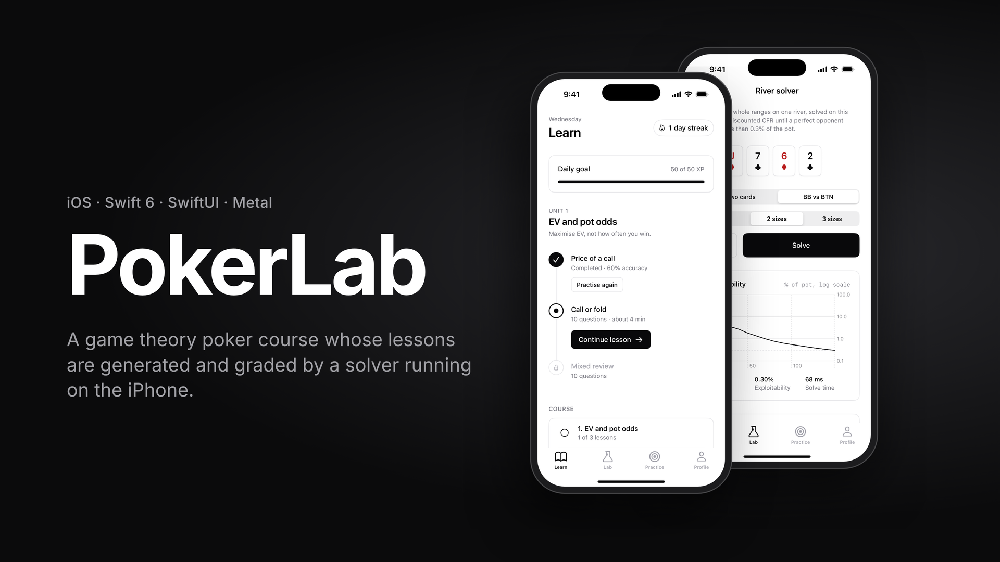
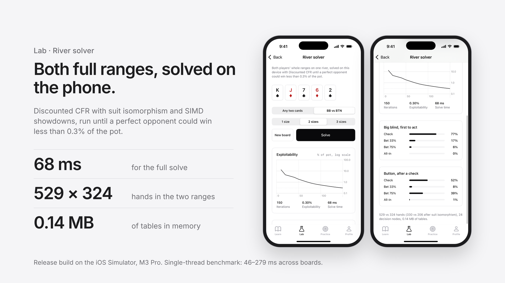
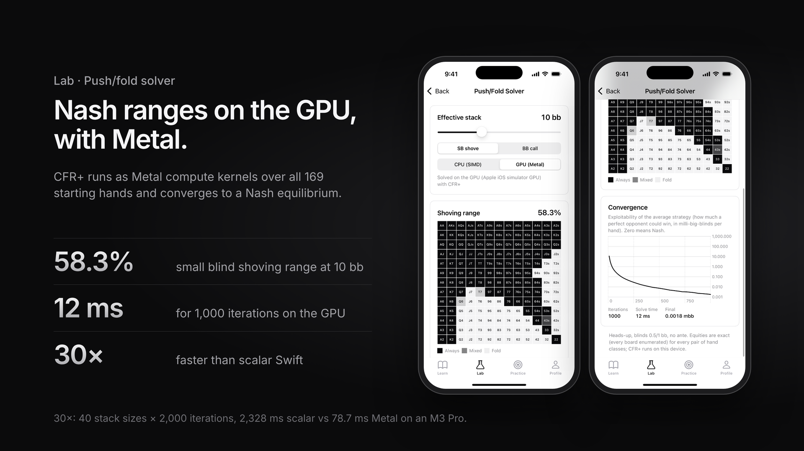
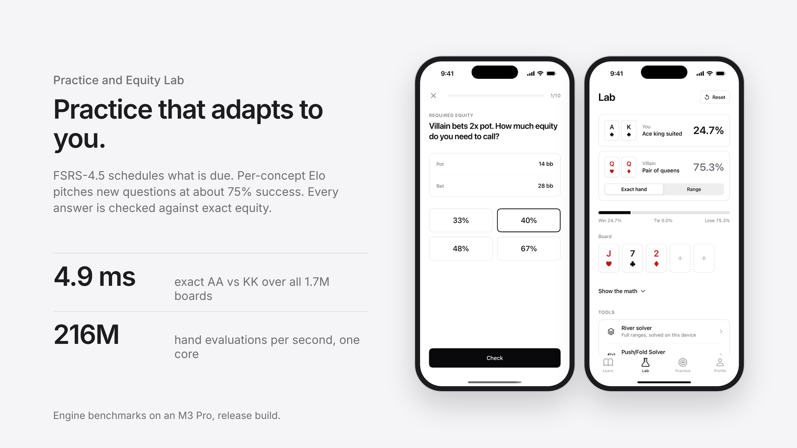

# PokerLab

An iOS 18 poker study app in Swift 6: a fast hand evaluator and equity engine, a CFR+
push/fold solver with a Metal path, spaced-repetition drills, and camera card reading.
Calm, first-party Apple look (no casino felt), with full VoiceOver labels, Dynamic Type,
Reduce Motion and an optional four-colour deck.

## Screenshots









## What's in the box

| Area | What it does |
|---|---|
| **Today** | Daily drill (the same spot for everyone that day), streak, recent accuracy, quick start |
| **Lab** | Equity Lab: card picker, villain hand or range (`AKs, QQ+, A5s-A2s`), board, live equity bars and a Swift Charts convergence plot fed by an `AsyncStream` |
| **Train** | Equity Quiz, Pot Odds and Range Trainer (paint a 13×13 grid against Nash), 10 spots per session; categories you miss come back more often |
| **Progress** | Accuracy over time and leaks by category (Swift Charts, aggregated off the main actor) |
| **Solver** | Heads-up push/fold Nash charts by stack depth with the exploitability curve |
| **Scan a Table** | AVCaptureSession + Vision pipeline for a Create ML card detector (model not included, see below) |
| **Extras** | Daily Drill widget (small, medium, Lock Screen), Live Activity for drill sessions (Lock Screen + Dynamic Island), App Intents / Siri Shortcuts, deep links `pokerlab://daily`, `pokerlab://drill/potOdds`, `pokerlab://solver`, `pokerlab://camera` |

## Architecture

```
pokerlab/
├── Engine/                       Swift package, Swift 6 language mode, strict concurrency
│   ├── PokerCore                 cards (UInt64 bitmasks), 7-card lookup evaluator + reference
│   │                             evaluator, exact and Monte Carlo equity, AsyncStream snapshots,
│   │                             range parser with card removal. No UI, no Foundation.
│   ├── PokerSolver               CFR+ push/fold (scalar, SIMD16, Metal), exploitability,
│   │                             shipped 169×169 preflop equity table
│   ├── PokerTraining             drill generators, grading, spaced repetition
│   ├── CardRecognitionCore       pure camera logic: label mapping, frame debouncing,
│   │                             hero/board layout, overlay geometry
│   ├── PokerBench                benchmark executable
│   └── PokerTables               offline generators for the shipped tables
├── App/
│   ├── PokerLab/                 SwiftUI app (App, Model, Design, Features, Intents)
│   ├── PokerLabWidgets/          WidgetKit extension: daily drill widget + Live Activity
│   ├── PokerLabUITests/          XCUITest drill-flow tests
│   └── Shared/                   App Group keys, daily seed, Live Activity attributes
└── project.yml                   XcodeGen spec (PokerLab.xcodeproj is generated from it)
```

Design choices worth knowing:

- **Engine is value types and `Sendable` throughout.** Parallel work is `TaskGroup` with one
  seeded xoshiro256 stream per child task, so Monte Carlo results are reproducible for a
  given seed. Cancellation is cooperative and checked once per batch.
- **The UI never blocks on the engine.** The Equity Lab consumes `EquityCalculator.equity(_:)`
  as an `AsyncStream`, throttles redraws to about 30 Hz and cancels the stream when cards change.
- **SwiftData models are CloudKit-compatible**: every property is optional or defaulted,
  relationships are optional, and there are no unique constraints. Sync is off until a
  container ID is set (see Setup).
- **Camera pipeline:** frames arrive on a dedicated queue and Vision runs synchronously
  there, with `alwaysDiscardsLateVideoFrames`, so a slow model analyses fewer frames instead
  of building a backlog. Detections leave the capture class as `Sendable` values.
  `FrameDebouncer` confirms a card after 5 hits in the last 8 frames and drops it below 2
  (hysteresis, so cards don't flicker). Cards in the lower third of the frame are the hero's
  hand; the rest are the board.

## Benchmarks

Measured on a MacBook Pro (Apple M3 Pro, 11 logical cores), release build. Full output,
methodology and the optimisation log are in [BENCHMARKS.md](BENCHMARKS.md). Nothing is
estimated. iPhone numbers are not measured yet (they need a device and a signing team).

| Measurement | Result |
|---|---|
| Fast evaluator, random 7-card hands, 1 thread | 216.5M hands/s (4,016× the reference evaluator) |
| Enumerate all 133,784,560 7-card hands, 11 tasks | 0.022 s (6.19B hands/s) |
| Monte Carlo AhKh vs QsQd, 11 tasks | 301.1M trials/s (7.0× one thread) |
| Exact AsAh vs KdKc, all 1,712,304 boards, 11 tasks | 4.9 ms |
| Push/fold CFR+, 40 depths × 2,000 iterations: scalar CPU | 2,328 ms |
| … SIMD16, 11 tasks | 87.5 ms |
| … Metal SIMD-group kernel | 78.7 ms GPU (1.1× the 11-task CPU path) |
| 10 bb Nash | shove 58.3%, call 37.4%; exploitability 0.002 mbb/hand after 1,000 iterations |

## Tests

```bash
cd Engine && swift test -c release -Xswiftc -enable-testing
```

73 Swift Testing tests: PokerCore 31, PokerSolver 11, PokerTraining 15, CardRecognitionCore 16.
They include the evaluator matching the reference on 1,000,000 random hands, exact category
counts over all 133,784,560 seven-card hands, and solver results matching published push/fold
charts. Run them in release: in a debug build the exhaustive evaluator tests saturate every
core, which makes the timing-based cancellation test (`cancellingTheConsumerStopsTheStream`)
time out.

UI tests (5: tabs, answering and advancing an Equity Quiz, a Pot Odds decision, ending a
session, a full 10-spot session):

```bash
xcodebuild -project PokerLab.xcodeproj -scheme PokerLab -destination 'platform=iOS Simulator,name=iPhone 16 Pro' test
```

## Setup

1. Install XcodeGen (`brew install xcodegen`), then generate the project:
   ```bash
   xcodegen generate
   ```
   Re-run it after adding or removing files. Open `PokerLab.xcodeproj`.
2. **Signing.** In `project.yml`, set `DEVELOPMENT_TEAM` to your team ID and change
   `bundleIdPrefix` / the `com.nicolelee.*` bundle IDs to your own reverse-DNS prefix.
   Simulator builds work without a team.
3. **App Group** (widget streak and daily-drill state). Create `group.<your prefix>.PokerLab`
   in the developer portal, then update it in `project.yml` (both targets' entitlements) and
   in `App/Shared/AppGroup.swift`.
4. **CloudKit sync.** Create a container such as `iCloud.<your prefix>.PokerLab`. Add it to
   `com.apple.developer.icloud-container-identifiers` in `project.yml` and set
   `AppConfig.cloudKitContainerID` in `App/PokerLab/App/PokerLabApp.swift` to the same
   string. While it's `nil`, data stays on the device.
5. **Card detector.** See the next section.

## Training the card detector

The scan screen is fully wired, but no model ships with the app: there's no training data
yet, and a fake model would be worse than none. Until you add one, the screen explains how.

1. **Collect photos.** Aim for 30–60 labelled examples of each of the 52 cards, more is
   better. Photograph real cards on the surfaces you'll actually play on, under different
   lighting (daylight, warm indoor, dim), at angles up to about 45°, at different distances,
   partly overlapped as in a real hand, and with several cards per photo. Use the phone's
   camera in portrait, since that's what the app analyses. Include some photos with no cards
   or only card backs, so the model learns what isn't a card face.
2. **Annotate.** Draw a box around each visible card face (or just the index corner if
   cards overlap heavily, consistently either way) and label it. Labels can be `As`, `AS`,
   `10h`, `Th`, `ace_of_spades` or `10_hearts`: `CardLabel` accepts all of these. Create ML
   wants a folder of images plus an `annotations.json` in its object-detection format;
   tools such as Roboflow, Label Studio or RectLabel export it directly.
3. **Train.** Open Create ML (Xcode ▸ Open Developer Tool ▸ Create ML), make a new
   **Object Detection** project, add the folder as training data, and hold back about 15%
   for validation. Use the Full Network algorithm (transfer learning trains faster but is
   usually weaker on 52 fine-grained classes). Train until validation mAP stops improving.
4. **Install.** Export the model as **`CardDetector.mlmodel`** (the exact name matters),
   put it in `App/PokerLab/Resources/`, run `xcodegen generate` and build. Xcode compiles it
   to `CardDetector.mlmodelc`, which `CardCaptureController` loads at runtime.
5. **Tune.** On a device, adjust `FrameDebouncer(window:minimumHits:releaseHits:minimumConfidence:)`
   in `CardScanModel` if cards confirm too slowly or flicker, and `heroBelow` in
   `TableLayout.split` if your hand isn't in the lower third of the frame.

## Still to do (needs Nicole)

- Apple Developer team ID, bundle ID prefix, App Group and CloudKit container (Setup steps 2–4).
- Training photos and a `CardDetector.mlmodel` (previous section). The camera pipeline has only
  been checked in the simulator, which has no camera. The capture-to-Vision path needs a
  device test once a model exists.
- iPhone benchmark numbers, which need a physical device.
- Siri phrases and the Live Activity were built and compiled but not exercised on a device.
